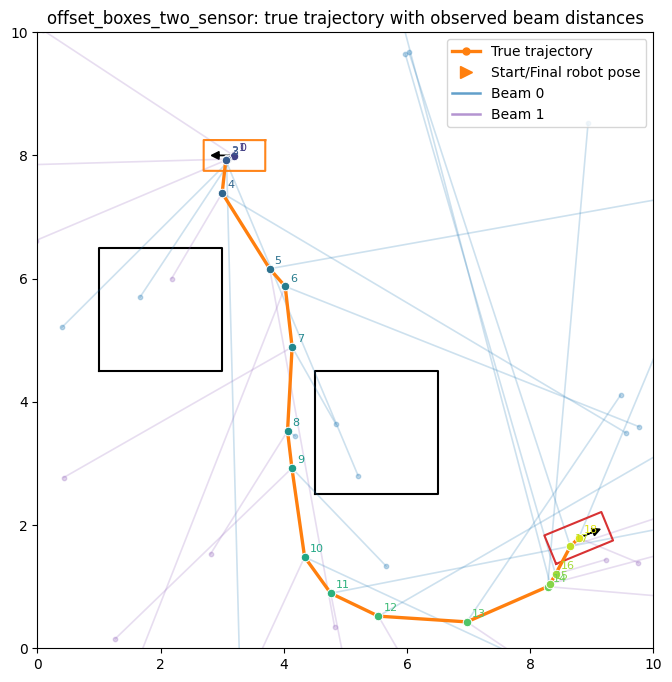
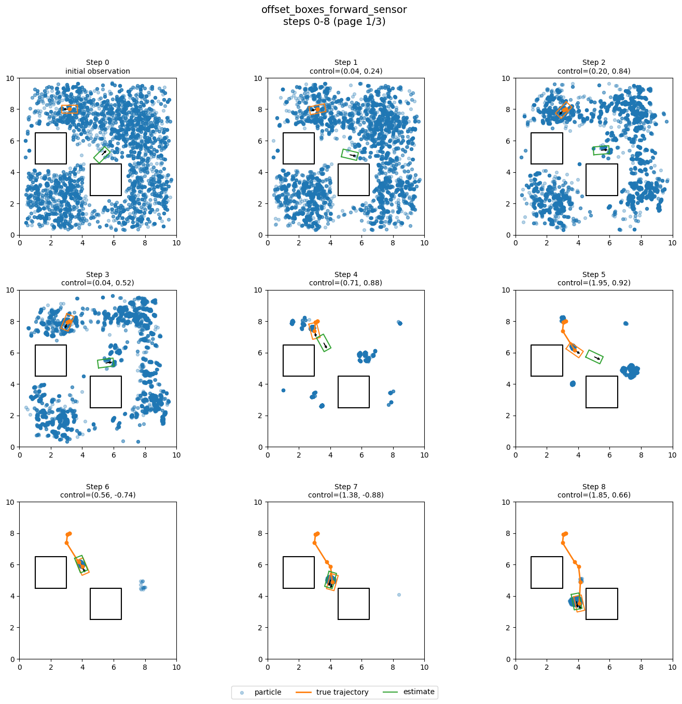
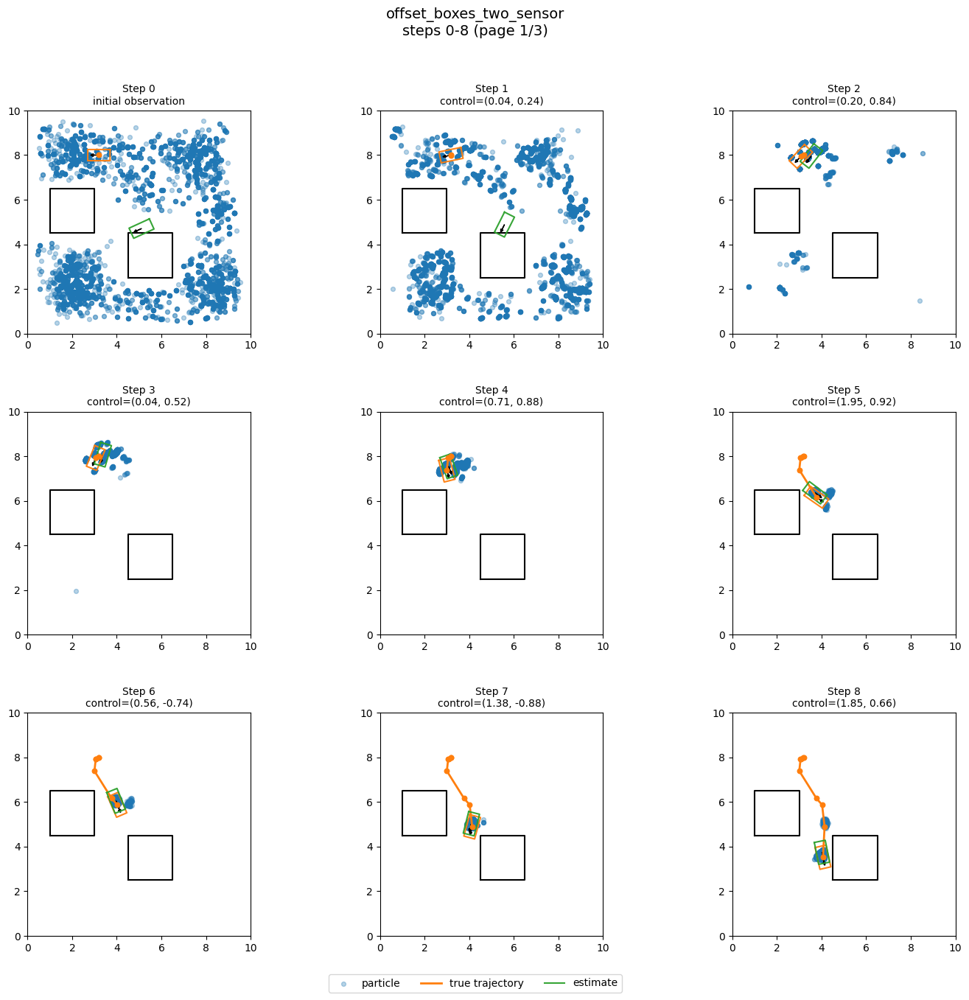

# CS440 Online Fall 2026, MP 6: HMM Tagging and Particle-Filter Localization
## Due: Sunday, November 15, 2026, 11:59 PM CST

## I. Overview

In this MP you will implement:

1. Baseline and HMM Viterbi parts-of-speech taggers
2. A particle filter for continuous robot localization using lidar observations

## II. Getting Started

Look inside the `template/` directory for the starter code. You will find:

Dependencies (no new ones since previous MPs) to be installed:

```bash
pip install -r requirements.txt
```

Files relevant to Part III:

* `baseline.py` - you will edit and submit this
* `viterbi.py` - you will edit and submit this, this is your main entry point for running part III code
* `utils.py` - helper code for loading and evaluating the tagging datasets
* `data/` - training and development datasets for POS tagging

Files relevant to Part IV:

* `particle_filter.py` - you will edit and submit this, this is your main entry point for running part IV code
* `localization.py` - provided simulator and plotting helpers for localization
* `cspace.py`, `robot.py` - provided geometry, motion, and lidar helpers
* `data/` - localization scenario JSONs

Please submit:

* `baseline.py`
* `viterbi.py`
* `particle_filter.py`

## III. HMM POS Tagging (50 points)

In this part you will implement part-of-speech tagging using a Hidden Markov Model (HMM), and comparing to a baseline. Your code should use the training data to estimate the HMM probabilities it needs, namely the transition and observation models, and then use those probabilities to infer tags for the test sentences.

Run this part with:

```bash
python viterbi.py --train data/brown-training.txt --test data/brown-dev.txt --algorithm baseline
python viterbi.py --train data/brown-training.txt --test data/brown-dev.txt --algorithm viterbi
```

The program reports:

* overall accuracy
* accuracy on words that appear with multiple tags in the training set
* accuracy on unseen words

Many words in the corpus have only one possible tag, so overall accuracy is easier to inflate than you might expect and is not necessarily so informative on its own. As you will see, multi-tag accuracy is especially useful for measuring the benefit of context, and unseen-word accuracy helps assess smoothing.

### Dataset Notes

The data consists of sentences from the Brown corpus where each word in the sentence is tagged with a part-of-speech tag. This version uses 16 part-of-speech tags, plus the two boundary tags added by the loader. Do NOT hard-code anything with respect to the start and end tags and just treating them like any other tag - that being said, they can be very helpful for *debugging* your code!

The provided loader:

* lowercases all words
* adds `START` and `END` tokens to each sentence
* ignores `START` and `END` when computing accuracy

Do not hardcode:

* the number of tags
* the names of tags
* any corpus-specific probabilities

The autograder will also test your code on hidden corpora whose tagsets differ from Brown.

### Baseline Tagger

The baseline tagger you need to implement in `baseline.py` ignores context. For each word `w`, it counts how many times `w` appears with each tag in the training set, then during prediction selects the most frequent tag for that word. For unseen words, it should predict the most frequent tag overall in the training set.

A correct baseline should reach roughly `94%` overall accuracy on the development set, but only around `90%` on words with multiple tags and `70%` on unseen words.

### Viterbi HMM Tagger

The Viterbi tagger should implement the standard HMM Viterbi algorithm from lecture for finding the most likely sequence of tags. The model makes two assumptions:

* the probability of the current tag depends only on the previous tag
* the probability of the current word depends only on the current tag

So the model uses:

* transition probabilities: $P(t_i \mid t_{i-1})$
* emission probabilities: $P(w_i \mid t_i)$
* initial probabilities for the first tag in the sentence: $P(t_0)$

The provided `viterbi(...)` function already loops over the sentence and repeatedly calls `stepforward(...)`. Your job is to:

1. Compute smoothed initial, transition, and emission probabilities in `train(...)`
2. Implement one update in `stepforward(...)`

### 1. `train(...)`

It is helpful to think of `train(...)` in two stages:

1. Compute counts:
   - Count how often each tag starts a sentence, how often each tag appears in general, and how often each tag comes after another tag
   - Count how often each word appears with each tag, i.e., emissions `count(tag, word)`
   - Count how often transitions occur, i.e., `count(prev_tag, next_tag)`
   - Count hapax words and their tags for emission smoothing (see below)
2. Convert counts into (log of) smoothed probabilities
   - Store `math.log(p)` in all three dictionaries: `init_prob`, `emit_prob`, and `trans_prob` (including `UNSEEN`). Precomputing these natural logs avoids repeated logarithms in the stepforward step

**For initial probabilities**, use Laplace smoothing: `(count_first(tag) + transition_epsilon) / (len(sentences) + transition_epsilon * K)`, where `K` is the number of distinct training tags. Include every observed tag, even if it never starts a sentence.

**For transitions**, use Laplace smoothing with the same provided `transition_epsilon = 1e-5` for every tag pair. Let $K$ be the number of distinct tags in training and `outgoing_count(previous)` count occurrences of the previous tag that are followed by another tag in the same sentence. Then

$$P(\text{current} \mid \text{previous}) = \frac{\text{count}(\text{previous}, \text{current}) + \text{transition\_epsilon}}{\text{outgoing\_count}(\text{previous}) + \text{transition\_epsilon} \cdot K}.$$

Include *every pair of observed tags*, including pairs never seen together. For example a tag with no outgoing transitions (like `END`) would get a uniform row, with probability $1/K$ for every next tag. Notice that we don't need to worry about "unseen" tags the way we do for words - tags are our labels and naturally we have to assume our training data covers the full tag list.

**For emissions**, smooth each tag separately. If `T` is a tag, let:

* `V_T` = number of distinct words seen with tag `T`
* `n_T` = total number of training tokens with tag `T`
* `alpha_T` = smoothing constant for tag `T` (see Hapax Smoothing below for computing the per tag `alpha_T`)

Then for any observed word `w` with tag `T`, the smoothed emission probability is:

$$P(w \mid T) = \frac{\text{count}(T,w) + \alpha_T}{n_T + \alpha_T (V_T + 1)}$$

and for unseen words with tag `T`, the smoothed emission probability is:

$$P(\text{UNSEEN} \mid T) = \frac{\alpha_T}{n_T + \alpha_T (V_T + 1)}$$

*You should include an explicit `UNSEEN` emission entry for every tag.*

#### Hapax Smoothing for Emissions

A **hapax** word is a word that appears *exactly once* in the training set. These words are important because they tend to have a tag distribution that is much closer to truly unseen test words than the full vocabulary distribution does. In other words, we can use these hapax words as a proxy for words we haven't seen.

Let:

* `hapax(T)` = number of hapax words whose tag is `T`
* `H` = total number of hapax words across all tags
* `alpha` = the provided base smoothing constant, `1e-5`

Use the following rule with the provided `emit_epsilon = 1e-5` as $\alpha$:

$$\alpha_T = \alpha \cdot \frac{\max(1, \text{hapax}(T))}{\max(1, H)}.$$

The `max` terms ensure that every tag's unseen probability is positive even if a tag has no hapax words.

#### Why hapax smoothing...?

The result of this redistribution of smoothing is that tags with more hapax words get a larger `UNSEEN` probability mass. It looks like a tiny modification, but it has a large effect because unseen-word decisions are exactly where the HMM is weakest. Even though the numeric change in `alpha_T` is small, it can change the **relative ranking** of tags for unseen words and therefore the predicted tag sequence.

Singleton words act as a proxy for unseen words:

* if singleton words are often nouns, then unknown words should be more noun-like
* if singleton words are rarely conjunctions, then unknown words should be less conjunction-like

### 2. `stepforward(...)`

The provided code initializes the first column of the trellis using the initial log tag probabilities and then iteratively calls your `stepforward(...)` method.

Let $b_i(t)$ be the score of the best partial tag sequence ending in tag $t$ after processing word $i$. Notice we use the word "score" because these are not real probabilities (we are not doing normalization). Moreover we will use sums of log probabilities rather than products of probabilities to avoid numerical underflow. Compute these scores as follows:

$$b_i(t') = \log P(w_i \mid t') + \max_{t} \left[b_{i-1}(t) + \log P(t' \mid t)\right]$$

Note:

- At `i = 0` do not apply a transition, just add the emission log probability to `prev_prob`
- Use the stored emission and transition log probabilities directly; do not take logs again
- For a word absent from a tag's emission dictionary, use that tag's explicit `UNSEEN` entry
- Return scores and tag-sequence lists for every tag. At column zero, each tag-sequence path is `[tag]`. At later columns, extend the best predecessor path with the current tag

## IV. Particle-Filter Localization (50 points)

<table style="width: 100%; table-layout: fixed; margin: 0 auto 1.5rem auto;">
<tr>
<td style="width: 33%; vertical-align: top; text-align: center;">

<div><strong>Visible two-beam replay scenario. The orange curve is the prerecorded true trajectory, and the short colored segments show the stored beam observations along that path. Notice that the observations are noisy!</strong></div>
</td>
<td style="width: 33%; vertical-align: top; text-align: center;">

<div><strong>Visible 1: one forward beam. Notice the filter is estimating the current state at each step; it is not estimating an entire trajectory the way we did in Viterbi.</strong></div>
</td>
<td style="width: 33%; vertical-align: top; text-align: center;">

<div><strong>Visible 2: two diagonal beams. Notice how we localize faster when we have two observations!</strong></div>
</td>
</tr>
</table>

In this part you will localize a rectangular Unicycle robot in a continuous 3D configuration space, $x_t = (p_x, p_y, \theta)$, using a particle filter. The robot has a known geometry and executes known controls, but both the controls and the sensor observations are noisy. The robot is equipped with one or two forward-facing range sensors (lidar beams) that return the distance to the nearest obstacle in their direction. The provided scenarios are generated by replaying a prerecorded true trajectory of the robot through an environment with polygonal obstacles, and recording noisy controls and noisy beam observations along that trajectory.

Each localization scenario (`data/localization_visible_[1-4].json`) contains:

* a workspace boundary and polygonal obstacles
* a start state and a sequence of controls
* a prerecorded true trajectory generated offline with noisy controls
* a prerecorded sequence of noisy range observations
* a geometric sensor model that you can query for arbitrary particle states

Your job is to complete the particle filter based localization code by filling in the missing functions in `particle_filter.py` - `update_belief`, `resample`, and `act`.

Run this part with:

```bash 
python particle_filter.py --env data/localization_visible_1.json
```
Replace `localization_visible_1.json` with any of the other available scenarios to experiment. You can also pass in `--num_particles` to change the number of particles, `--seed` to set the random seed, and `--show` to visualize the results or `--save` to save the visualization. If a run produces multiple figure pages, they will be saved as `..._1.png`, `..._2.png`, and so on.

### Public and Hidden Scenarios

The provided four files form two environment pairs:

* `visible_1` and `visible_2` share the same environment and replayed true trajectory, but `visible_1` has one beam and `visible_2` has two beams
* `visible_3` and `visible_4` are a second environment pair with the same one-beam / two-beam structure

The gradescope tests use unseen scenarios but follow the same general format.

For each hidden localization scenario, the autograder scores according to the final fraction of particle weight within some distance of the true $(p_x, p_y)$ position.

### Code Structure

The localization code is organized around two provided abstractions in `localization.py`:

1. `LocalizationProblem`

   This stores the scenario definition loaded from a JSON file, including the robot, the start state, the controls, the beam directions, the noise parameters that were used to generate the replay data, and optionally prerecorded `true_states` and `observations`.

2. `LocalizationSimulator`

   This is the simulator that provides the online interface used by your filter. It provides the following operations:

   * `observe()` - returns the current observation from the replayed scenario
   * `observe_config(config, noisy=False)` - returns the expected beam distances for any candidate particle configuration
   * `propagate_config(config, control, control_noise=None)` - propagates a particle through the noisy motion model
   * `step(control)` - advances the replayed true state by one time step

For the provided scenarios, the simulator replays stored `true_states` and `observations` if they are present in the JSON file. If you create your own custom scenario file without replayed data, the same simulator can still generate motion and observations online from the model.

The particle filter code is organized around the `run_particle_filter(...)` function in `particle_filter.py`, which runs the overall particle filter loop. The helper functions `initialize_valid_particles(...)`, `estimate_state(...)`, and `run_particle_filter(...)` are already provided, your job is to fill in the missing pieces of that loop by implementing only the three missing functions:

* `update_belief(...)`
* `resample(...)`
* `act(...)`

Particles, weights, and beam observations are real numeric NumPy arrays with shapes `(N, 3)`, `(N,)`, and `(B,)`, respectively. Return particle and weight arrays in this same representation. The grader calls the three required functions directly, using their default noise values for localization.

### Observation Update: `update_belief(...)`

This function returns nonnegative posterior weights summing to one.

Suppose the current particle set is $\left\{x_t^{(1)}, x_t^{(2)}, \ldots, x_t^{(N)}\right\}$ with prior weights $\left\{w_t^{(1)}, w_t^{(2)}, \ldots, w_t^{(N)}\right\}$. Let the sensor observation at this time step be the beam-distance vector $z_t = (z_{t,1}, z_{t,2}, \ldots, z_{t,B})$.

For each particle, use the simulator to compute the expected measurement $h\!\left(x_t^{(i)}\right)$.

The provided observation model assumes independent Gaussian noise on each beam, $\mathcal{N}(z; \mu, \sigma^2) = \frac{1}{\sqrt{2\pi}\sigma}\exp\left(-\frac{(z-\mu)^2}{2\sigma^2}\right)$, and therefore, for beam $b$,

$$ p(z_{t,b} \mid x_t^{(i)}) =
\frac{1}{\sqrt{2\pi}\sigma}
\exp\left(
    -\frac{\left(z_{t,b} - h_b\!\left(x_t^{(i)}\right)\right)^2}{2\sigma^2}
\right)$$

and assuming the beam noises are independent, the full observation likelihood is the product across beams, $p(z_t \mid x_t^{(i)}) = \prod_{b=1}^{B} p(z_{t,b} \mid x_t^{(i)})$. Note that $\sigma$ is the **particle observation-noise standard deviation that you choose for your filter** which can be different than the noise used to generate the true data. To reiterate, the scenarios are generated using one sensor noise, but your particle filter is expected to use a **tuned particle observation noise** that works well for filtering. In other words, you should experiment on the visible scenarios, choose a good value, and then set the **default value in the function signature** to your tuned value so that your full `run_particle_filter(...)` uses it.

Given the above observation model the standard Bayes-filter update is:

$$\tilde{w}_t^{(i)} = w_t^{(i)} \, p(z_t \mid x_t^{(i)})$$

and then normalize the weights:

$$w_t^{(i)} = \frac{\tilde{w}_t^{(i)}}{\sum_j \tilde{w}_t^{(j)}}.$$

The equations above, while correct, will lead to numerical underflow/overflow. To avoid this, one approach is to compute the sum of logs (to avoid underflow from the product) and then exponentiate after subtracting the maximum value (this avoids overflow of exponentiating a large value while not affecting post normalization values) before normalizing:

$$\ell_i = \log w_t^{(i)} + \sum_{b=1}^{B}\left[-\log(\sqrt{2\pi}\sigma) - \frac{\left(z_{t,b} - h_b\!\left(x_t^{(i)}\right)\right)^2}{2\sigma^2}\right].$$

For zero prior weights, set $\ell_i = -\infty$ so their posterior weights remain zero.

$$m = \max_i \ell_i, \qquad u_i = \exp(\ell_i - m).$$

$$w_t^{(i)} = \frac{u_i}{\sum_j u_j}.$$

### Resampling: `resample(...)`

Given particles $\left\{x^{(1)}, \ldots, x^{(N)}\right\}$ with normalized weights $\left\{w^{(1)}, \ldots, w^{(N)}\right\}$, resampling draws new ancestor indices

$$a_j \sim \text{Categorical}\!\left(w^{(1)}, \ldots, w^{(N)}\right)$$

and thus creates the new particle set $x_{\text{new}}^{(j)} = x^{(a_j)}$. In other words we draw `N` times with replacement from our particle set according to the weights. After resampling, all particles should receive uniform weights:

$$w_{\text{new}}^{(j)} = \frac{1}{N}.$$

The point of resampling is to focus the particle set on the high-probability regions of the state space by replicating particles with high weights and eliminating particles with low weights. We do this to address weight degeneracy (where over time our weight distribution becomes very skewed), but repeated resampling can reduce particle diversity (sample impoverishment). Motion noise (next section) will help us maintain diversity...

### Motion Update: `act(...)`

Let the control at the current step be $u_t$. For each particle $x_t^{(i)}$, your motion update samples one noisy successor $x_{t+1} \sim p(x_{t+1} \mid x_t^{(i)}, u_t)$ by querying the simulator's `propagate_config(...)` function. If the simulator returns `None` for a particle, that means the particle's motion would have resulted in a collision, so you should keep the old particle instead of propagating it (let resampling remove this particle in a future iteration if relevant).

The data was generated with a specific noisy motion model, i.e., using `simulator.problem.control_noise`. Like with observation noise, it is tempting to directly use this noise when propagating particles forward, but in practice particle filters often work better with a relatively diffuse particle action model to avoid collapse. Therefore, similar to the observation noise, you should experiment with a **tuned particle action noise** that works well for filtering. In other words, you should not necessarily use the same noise that was used to generate the data, but rather choose a noise level that works well across the visible scenarios.

## Submission Instructions

Submit `baseline.py`, `viterbi.py`, and `particle_filter.py` to Gradescope. Do not forget to access Gradescope from the Launch App button in Coursera and to comment out print statements to avoid timeouts.

## Policies

You are expected to be familiar with the general course policies, including academic integrity. This is an individual assignment and the code you submit must be your own work.
